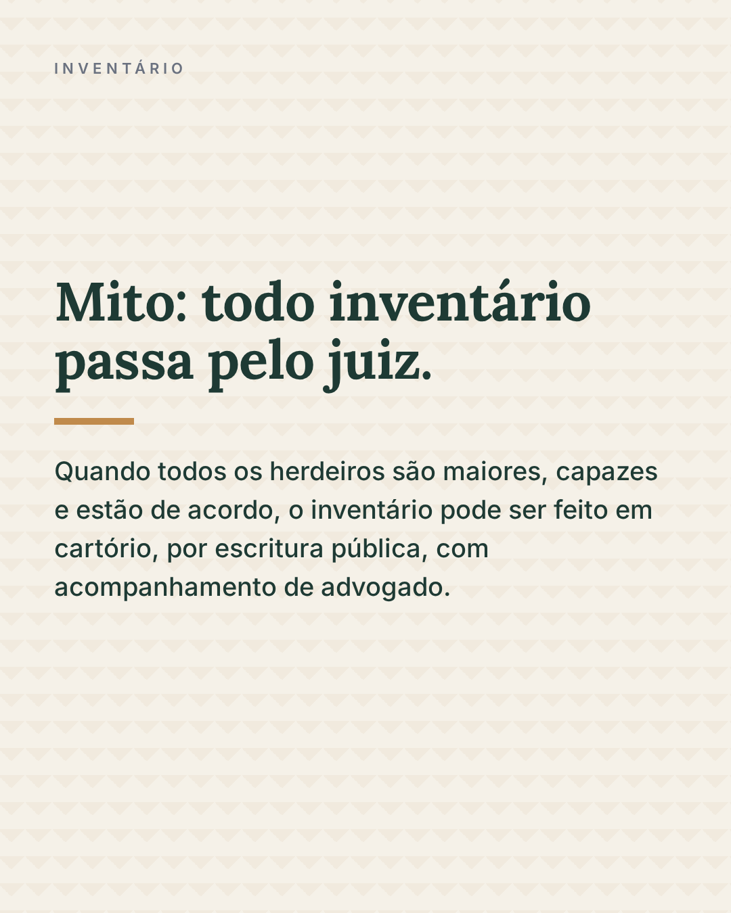

# Gerador de carrossel para Instagram

Duas skills de IA que trabalham juntas para criar posts de Instagram, do texto à
arte final em PNG:

1. **[instagram-conteudo](instagram-conteudo/)** planeja os posts (avulsos ou
   carrossel) a partir de um tema e do perfil do cliente: texto de cada página,
   legenda, hashtags e direção visual. Respeita as regras de publicidade de
   cada profissão (OAB, CFM, CFO, CFP…).
2. **[instagram-render](instagram-render/)** transforma esse conteúdo em artes:
   primeiro HTML editável para revisar no navegador, depois os PNG finais.

Funcionam com qualquer IA que leia skills no formato `SKILL.md` (Claude Code,
Codex, Gemini CLI, Copilot…) e o render também roda sem IA, pelo terminal.

<p>
  
  
  
</p>

<sub>Artes geradas a partir do cliente fictício que vem no repositório.</sub>

## Como funciona

```
tema + perfil do cliente
        │
        ▼
instagram-conteudo ──► campaign-data.json ──► instagram-render ──► HTML (revisão) ──► PNG
```

- Cada campanha termina com uma **imagem de fechamento** ("Gostou do
  conteúdo?"), nas cores da campanha.
- As artes saem com nomes fáceis de achar: `post-06_slide-09.png` é o slide 9
  do post 6; `post-03.png` é um post avulso.
- Formatos: feed (1080 × 1350, padrão), quadrado (1080 × 1080) e story
  (1080 × 1920).

## Instalação

Requisitos: [Node.js](https://nodejs.org/) 18 ou mais recente.

```bash
git clone https://github.com/Vangl-dev/skill-gerador-carrossel-instagram.git
cd skill-gerador-carrossel-instagram/instagram-render
npm install
npx playwright install chromium
```

Para a IA enxergar as skills, ligue as duas pastas à pasta de skills dela. No
Claude Code, por exemplo:

```bash
ln -s "$PWD/../instagram-conteudo" ~/.claude/skills/instagram-conteudo
ln -s "$PWD"                       ~/.claude/skills/instagram-render
```

Outras IAs usam pastas parecidas (`~/.codex/skills`, `~/.gemini/skills`…). Para
IAs no navegador, envie um zip de cada pasta de skill.

## Teste rápido com o cliente de exemplo

O repositório traz um escritório fictício com perfil e campanha prontos:

```bash
cp -r ../instagram-conteudo/exemplo/escritorio-exemplo /tmp/
node scripts/render.js /tmp/escritorio-exemplo           # gera os HTML
# abra /tmp/escritorio-exemplo/campanhas/<campanha>/html/index.html
node scripts/render.js /tmp/escritorio-exemplo --png     # exporta os PNG
```

## Uso com IA

Peça algo como *"cria um carrossel sobre inventário para o cliente em
~/Projetos/escritorio"*. A IA:

1. lê o perfil do cliente (`identidade.md`) e, se faltar algo, pergunta;
2. escreve os posts e mostra para você aprovar;
3. gera os HTML e a galeria de revisão;
4. depois da sua aprovação, exporta os PNG.

## Pasta do cliente

Os dados de cada cliente ficam fora das skills, numa pasta própria:

```
<cliente>/
    identidade.md          cores, fontes, logo, público, tom de voz e regras do setor
    campaign-data.json     campanha atual (escrito pela instagram-conteudo)
    assets/                logo.png, fotos e fundos
    templates/
        fechamento.html    imagem de fechamento (modelo no cliente de exemplo)
    campanhas/             criada pelo render, uma pasta por campanha
```

Os detalhes estão no `LEIA-ME.md` de cada skill.

## Licença

[MIT](LICENSE)
